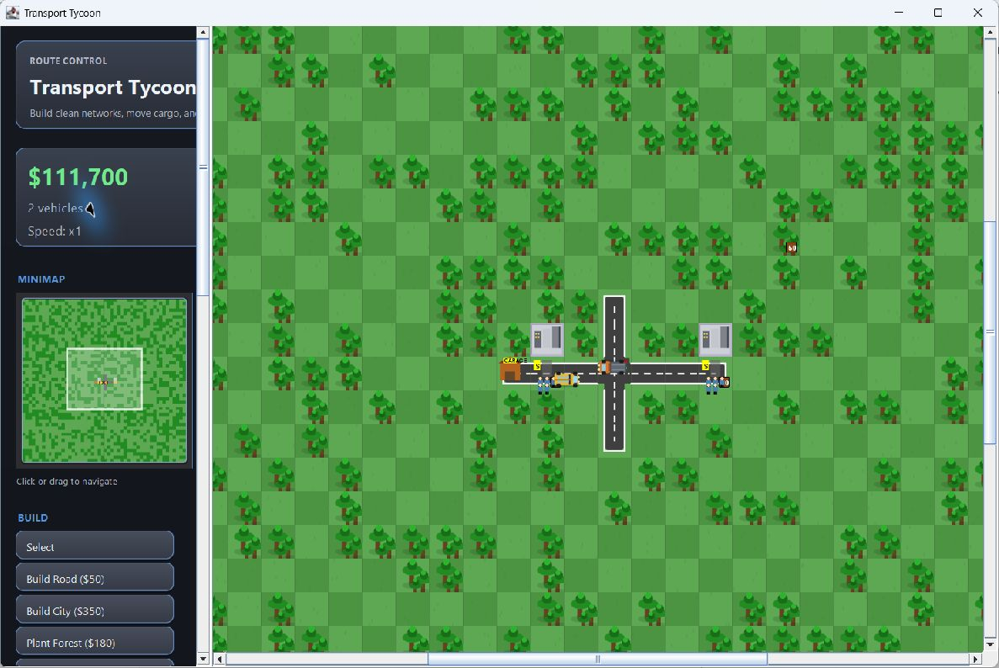
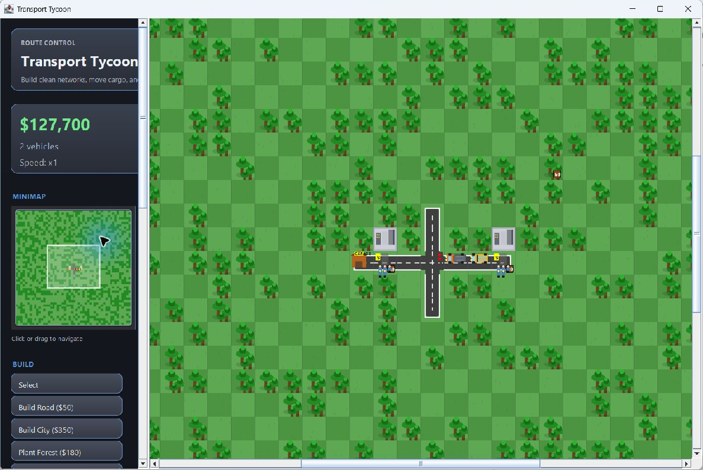
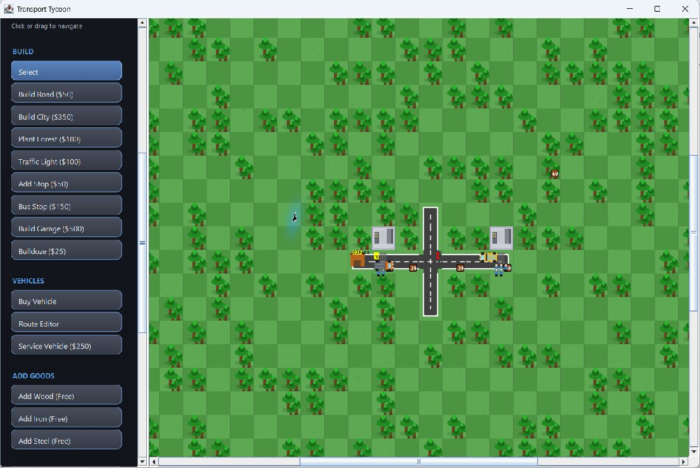
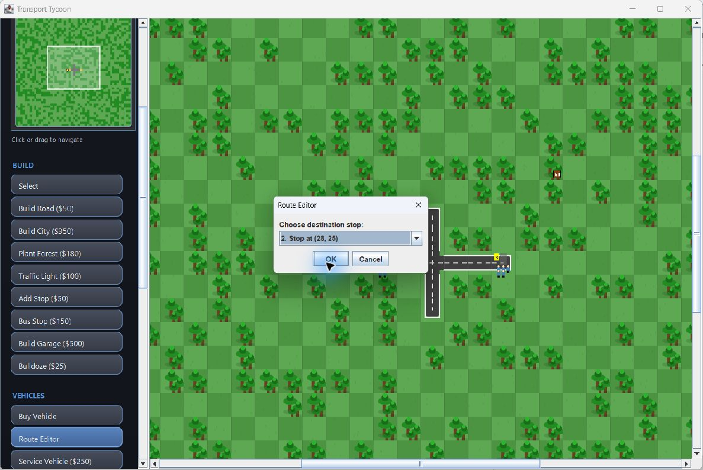
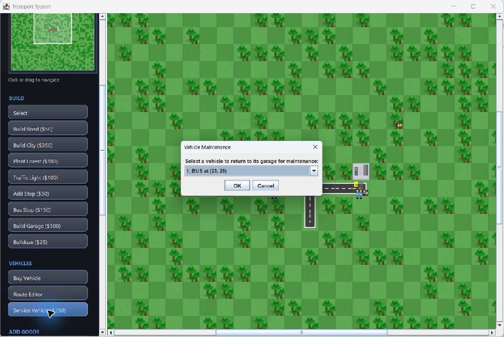

# Transport Routes

### A Java desktop transport simulation

An individually developed Java game by **Toghrul Hasanli**. Build a road network, manage a fleet, and move passengers and cargo across a tile-based map. Transport Routes combines a Swing interface with custom Java2D rendering, BFS route planning, and a persistent simulation state.

[Gameplay preview](#gameplay-preview) · [Run the game](#run-the-game) · [Controls](#controls) · [Implementation](#technical-highlights) · [Tests](#tests)

## Gameplay preview

The application window is titled **Transport Tycoon**. These captures come directly from the running, unmodified game. The demonstration uses the starter road network, two bus stops, a garage, city blocks, a traffic light, a bus, and a cargo truck. Goods were placed using the normal in-game controls.



**Live simulation — 12.67 seconds.** The bus and cargo truck follow their routes while the traffic light cycles. This is a real-time screen capture sampled at approximately four frames per second, not a claim about the game's rendering frame rate.


### Transport and fleet management

| Passenger service | Cargo transport |
| --- | --- |
|  |  |
| A bus operates between stops; the minimap tracks the fleet. | Goods markers show stock on roads and at stops. |

| Route management | Vehicle servicing |
| --- | --- |
|  |  |
| Choose a destination stop for a BFS-generated return route. | Select a garage vehicle for servicing; this image shows the selection dialog. |

Open any image for its full-size view. The [media notes](docs/screenshots/README.md) describe capture provenance, reproduction steps, and the original initial-state image. No generated gameplay images or altered game code were used.

## Overview

Transport Routes is a transport management sandbox built around a 50 × 50 grid. Start with $10,000 and a small central road network, extend connected roads, place garages and stops, then assign vehicles to looping routes. Balance construction and vehicle purchases against income from passenger and cargo pickups.

The project demonstrates object-oriented Java development through interacting map, vehicle, simulation, persistence, and desktop interface components.

## Features

- **Network construction:** connected roads, garages, two stop types, traffic lights, cities, forests, and a bulldozer tool.
- **Three vehicle types:** cars (4 passengers), buses (20 passengers), and cargo trucks (30 goods), with distinct speeds and purchase prices.
- **Route Editor:** choose a vehicle and destination stop; BFS finds a connected road path and creates a return route.
- **Passenger and cargo mechanics:** capacity-limited pickups, passenger drop-offs at stops, and wood, iron, and steel goods. Revenue is credited on pickup.
- **Traffic behavior:** vehicles wait at red lights and for vehicles occupying the next tile in the same direction.
- **Vehicle servicing:** send a vehicle to its home garage, wait for servicing, and restore its previous route state.
- **Simulation controls:** pause and 1×, 2×, or 4× speed.
- **Map navigation:** scrollable map, keyboard panning, and an interactive minimap showing vehicles and the visible area.
- **Named save files:** save and load tile contents, vehicles, routes, balances, statistics, and maintenance state.

Cities are placeable map elements. This version does not implement a complete city-demand or industrial supply-chain system.

## Technologies

| Technology | Role |
| --- | --- |
| Java (release target 23) | Game logic and data models |
| Swing / AWT | Desktop interface, input, timers, and dialogs |
| Java2D | Custom map, vehicle, minimap, and notification rendering |
| Java I/O serialization | Local game-state snapshots |
| Maven | Compilation, resources, packaging, and test execution |
| JUnit Jupiter 5.10.0 | Existing unit tests |

There are no external runtime dependencies or separate game engine. Maven uses Compiler Plugin 3.13.0 and Surefire 3.2.5.

## Requirements

- **JDK 23 or later**, with `java` and `javac` on your PATH. A Java 8 runtime cannot run this project.
- **Apache Maven** on your PATH. Validation used Maven 3.9.11 and JDK 25.0.1 with release target 23.
- A graphical desktop session for Swing.
- Internet access for the first Maven build to download dependencies and plugins.

## Run the game

Run all commands from the directory containing `pom.xml` (the inner `team-6-master/` directory in the original project folder).

1. Check your tools:

   ```sh
   java -version
   javac -version
   mvn -version
   ```

2. Build the project and run its existing tests:

   ```sh
   mvn package
   ```

3. Launch the game:

   ```sh
   java -cp target/classes com.transportroutes.Main
   ```

   You can also launch the packaged JAR using its classpath:

   ```sh
   java -cp target/TransportRoutesTransNetSim-1.0-SNAPSHOT.jar com.transportroutes.Main
   ```

The JAR has no executable `Main-Class` manifest, so use the classpath commands above. No IDE is required. In an IDE, import the Maven project, select a compatible JDK, and run `com.transportroutes.Main`.

### First playable route

1. Click the center of the minimap to locate the starter roads.
2. Select **Build Garage ($500)**, click an existing road tile, and confirm.
3. Place a **Bus Stop ($150)** on a different connected road tile. Build actions generally return to Select after placement.
4. In **Select** mode, click the garage and choose **Buy Vehicle**. Purchase a car or bus.
5. Open **Route Editor**, choose your vehicle, then choose the stop.
6. Use **Add Passengers** on a road along the route before the stop to demonstrate pickups. Bus stops also spawn passengers over time.
7. For a cargo example, buy a cargo truck, assign a route to a bus stop, select **Add Wood**, and click a road along that route.

Use connected roads throughout. Cities are not required to operate a route. Forest tiles can contain goods but are not drivable; placing goods on a reachable road is the simplest cargo demonstration.

## Controls

| Input / interface | Action |
| --- | --- |
| Sidebar tool, then map click | Place or remove the selected structure, or add goods/passengers |
| Select, then click a garage | Select the garage for purchases and service |
| Route Editor | Select a vehicle and destination stop |
| Arrow keys / W A S D | Pan the map |
| Map scrollbars / mouse wheel | Navigate the scrollable map |
| Minimap click or drag | Move the visible map area |
| Pause / Speed x1 / x2 / x4 | Change simulation speed |
| Save Game / Load Game | Write or restore a named local save |
| Open Help | Display the in-game help |

The sidebar itself scrolls to reveal additional controls. There are no documented keyboard shortcuts for building or saving.

## Project structure

```text
.
├── pom.xml
├── src/main/java/com/transportroutes/
│   ├── Main.java           # Swing application entry point
│   ├── core/               # Central game state and updates
│   ├── map/                # Tile grid and tile behavior
│   ├── transport/          # Vehicles, routes, garages, stops, goods
│   ├── simulation/         # BFS pathfinding and simulation timer
│   ├── persistence/        # Serializable snapshots and save-file I/O
│   ├── economy/            # Standalone balance model
│   └── ui/                 # Window, map, minimap, tools, notifications
├── src/main/resources/assets/
├── src/test/java/com/transportroutes/
└── docs/
    ├── screenshots/        # Real gameplay screenshots, GIF, and capture notes
    ├── PORTFOLIO.md        # CV copy and GitHub metadata
    └── PUBLISHING.md       # Review checklist and publication commands
```

Local saves and `target/` build output are excluded from Git. `EconomyManager` is a standalone model; the active game balance is managed in `Game`.

## Technical highlights

- **Graph traversal:** `PathFinder` searches four orthogonal neighbors with BFS, stores predecessor directions, and reconstructs a shortest path through drivable tiles. Return routes reverse the outbound path.
- **Object-oriented design:** separate classes represent map tiles, vehicles, routes, garages, goods, and saved state. Packages distinguish simulation, persistence, and presentation responsibilities; some construction interactions reside in the UI.
- **Simulation and rendering:** a 50 ms Swing timer advances simulation updates; a separate 16 ms timer updates interpolated vehicle positions and requests repainting. These are timer intervals, not measured frame-rate guarantees.
- **Vehicle state transitions:** movement, stop waits, traffic-light waits, maintenance travel, servicing, and route restoration are represented explicitly in vehicle state.
- **Custom rendering:** Java2D draws roads according to adjacent connections, vehicle shapes and headings, passengers, goods, and overlays. The minimap maps viewport coordinates to full-map coordinates.
- **Persistence:** dedicated serializable snapshot classes capture map and vehicle data without serializing Swing components. Saves are stored relative to the process working directory in `saves/`.

Only load save files you trust: the current format uses Java object deserialization. Legacy `.dat` files are not listed by the current `.sav` loader.

## Tests

```sh
mvn test
```

The existing suite contains 59 tests across seven classes covering game balances and collections, tiles and capacity limits, route storage, garages, vehicle state, and passenger pickup/drop-off behavior. Some checks are basic smoke checks; this is not a coverage claim, and there are no dedicated BFS or save/load round-trip tests in the current suite.

Validation results are recorded in [PUBLISHING.md](docs/PUBLISHING.md). Tests are unchanged.

## Author

**Toghrul Hasanli** independently designed and implemented the game's software architecture, Java programming, gameplay logic, transport simulation, desktop interface, and persistence system. Transport Routes is presented as a personal software development portfolio project.

See the [portfolio notes](docs/PORTFOLIO.md) for the CV-ready project description and GitHub metadata.

## Assets and permissions

All game artwork, including `bus.png`, `car.png`, `truck.png`, and `tree.png` under `src/main/resources/assets/`, is original work by **Toghrul Hasanli**. The author confirms that no game assets were downloaded or copied from the internet. The gameplay screenshots and GIF show the author's game; the current renderer draws game objects with Java2D.

Third-party development and test tools retain their own licenses; see [dependency and attribution notes](docs/THIRD_PARTY.md). No project LICENSE has been selected yet. Public availability does not itself grant a general license to reuse the original code or artwork. This project is not presented as affiliated with the commercial Transport Tycoon game.
